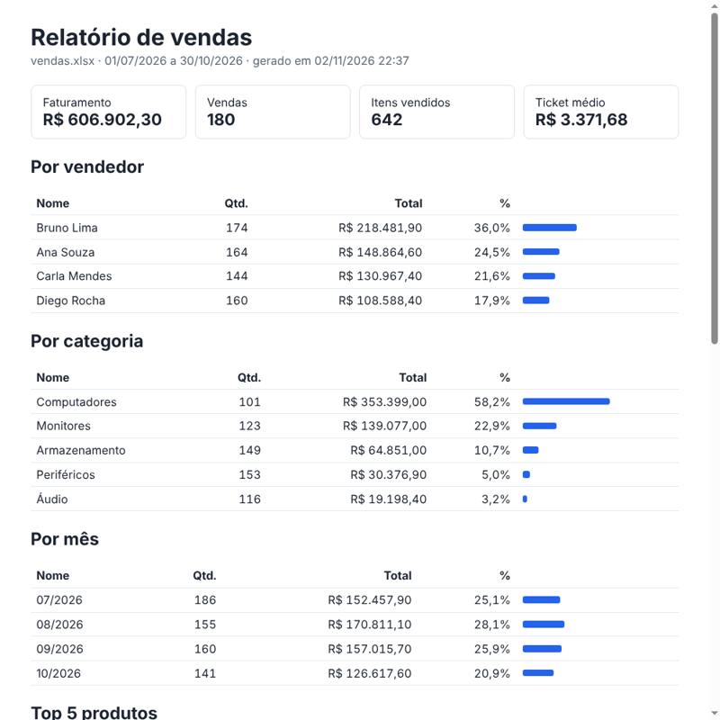

# Relatório de Planilhas

Robô em **C# (.NET 8)** que lê uma planilha de vendas em Excel e gera um relatório pronto: faturamento, ranking de vendedores, categorias, evolução por mês, produtos mais vendidos e metas atingidas.

É o tipo de automação que tira horas de trabalho manual de quem monta relatório toda semana copiando e colando no Excel.



## O que ele faz

- **Lê o .xlsx sem biblioteca externa**: abre o arquivo (que é um ZIP de XMLs) e interpreta textos, números e datas do Excel
- **Acha as colunas pelo nome** do cabeçalho, sem depender da ordem nem de acento/maiúscula
- **Não para por causa de uma linha ruim**: linhas com quantidade inválida, vendedor em branco ou preço faltando são ignoradas e listadas no relatório, com o número da linha
- **Compara com metas** se a planilha tiver a aba `Metas`
- **Gera** `relatorio.html` (para abrir no navegador ou mandar por e-mail) e `resumo.csv` (abre direto no Excel em português)

## Como rodar

Precisa do [.NET 8 SDK](https://dotnet.microsoft.com/download).

```bash
dotnet run --project src/RelatorioPlanilhas -- exemplos/vendas.xlsx
```

O relatório sai na pasta `relatorio/`. Para escolher outra pasta: `-- exemplos/vendas.xlsx minha-pasta`.

## Formato da planilha

Aba **Vendas** com as colunas `Data`, `Vendedor`, `Produto`, `Categoria`, `Quantidade` e `Preço Unitário` (em qualquer ordem). Opcional: aba **Metas** com `Vendedor` e `Meta mensal`. O arquivo `exemplos/vendas.xlsx` tem 180 vendas de exemplo e 3 linhas com erro de propósito.

## Estrutura

```
src/RelatorioPlanilhas/Excel/LeitorXlsx.cs          leitura do .xlsx (ZIP + XML)
src/RelatorioPlanilhas/Vendas/ImportadorVendas.cs   linhas → vendas, com validação
src/RelatorioPlanilhas/Relatorio/Resumo.cs          totais, rankings e metas
src/RelatorioPlanilhas/Relatorio/Geradores.cs       saída em texto, CSV e HTML
src/RelatorioPlanilhas/Program.cs                   linha de comando
```

## Tecnologias

C# · .NET 8 · LINQ · System.IO.Compression · LINQ to XML
